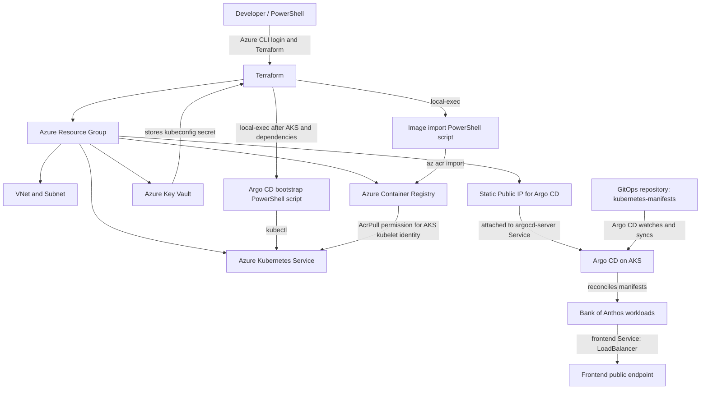

# Terraform AKS + Argo CD + Bank of Anthos

A learning project that provisions Azure infrastructure with Terraform, installs Argo CD on Azure Kubernetes Service (AKS), imports application container images into Azure Container Registry (ACR), and uses Argo CD to deploy Bank of Anthos from a GitOps repository.

> **Status:** Learning/demo project. Review the Terraform plan, Azure permissions, image sources, and networking before deploying. The current bootstrap script exposes Argo CD over a public LoadBalancer and prints the initial admin password to the terminal. Do not use this setup for production without hardening it.


## Architecture



### Deployment flow

1. Terraform creates the resource group, VNet/subnet, AKS cluster, ACR, Key Vault, public IP, and role assignments.
2. The image-import script copies the configured Bank of Anthos images into ACR.
3. The bootstrap script obtains temporary AKS credentials, installs Argo CD, configures the Argo CD LoadBalancer to use the Terraform-created public IP, and creates an Argo CD Application.
4. Argo CD watches the configured Git repository and syncs the `kubernetes-manifests` path into the cluster.
5. Kubernetes pulls images and runs the Bank of Anthos components.

## Repository layout

```text
.
├── main.tf
├── provider.tf
├── variable.tf
├── output.tf
├── locals.tf                 # environment-specific node count and VM SKU lookup
├── dev.tfvars
├── test.tfvars
├── prod.tfvars
└── scripts/
    ├── bootstrap-argocd.ps1
    └── import-bank-of-anthos-images.ps1
```

The exact files may differ if you use the earlier, non-environment-aware version. Keep the Terraform files and `scripts/` directory together because the Terraform configuration calls the scripts using paths relative to the project directory.

## Prerequisites

Install these tools on the machine running Terraform:

- Azure CLI (`az`)
- Terraform (the configuration pins AzureRM provider `5.0.0` and uses the AzureAD and Random providers in the environment-aware version)
- `kubectl` (the bootstrap script requires it to be available in `PATH`; Azure CLI can install it with `az aks install-cli`)
- PowerShell (the `local-exec` provisioners invoke PowerShell)
- Git

You also need:

- An Azure subscription with sufficient quota and available VM capacity in the selected region.
- Permission to create the Azure resources in this project and to create role assignments.
- A globally unique ACR name. ACR names are globally unique across Azure, not just within a resource group.
- Access to the GitOps repository configured in `scripts/bootstrap-argocd.ps1`.

## Azure authentication

You can authenticate using an interactive user login for a personal learning subscription, or a service principal for repeatable automation. Prefer a dedicated service principal with narrowly scoped permissions. Do not commit credentials to Git.

### Option A — Interactive login (local learning)

```powershell
az login
az account list --output table
az account set --subscription "<SUBSCRIPTION_ID_OR_NAME>"
az account show --output table
```

### Option B — Create a service principal

Run this as an identity that is authorized to create service principals and role assignments. Replace the subscription ID with your own.

```powershell
$subscriptionId = "<SUBSCRIPTION_ID>"
az account set --subscription $subscriptionId

# Creates a service principal with Contributor at subscription scope.
az ad sp create-for-rbac `
  --name "sp-terraform-aks-lab" `
  --role "Contributor" `
  --scopes "/subscriptions/$subscriptionId"
```

Save the returned `appId`, `password`, and `tenant` securely. The password is shown only at creation time. Never paste it into a README, source file, screenshot, or commit.

**Role-assignment permission is also required.** This Terraform project creates role assignments for Key Vault access, AKS-to-ACR image pulls, and AKS networking. `Contributor` alone generally cannot create role assignments. Have a subscription administrator grant the service principal `User Access Administrator` or `Role Based Access Control Administrator` at the appropriate scope, or use `Owner` for a disposable lab subscription if your organization explicitly permits that. `Owner` is highly privileged and should not be the default choice for a company subscription.

### Set credentials as environment variables (PowerShell)

Use these in the current PowerShell session. Replace the placeholders with the service principal values returned by Azure CLI. These are session-only and are not saved to your PowerShell profile.

```powershell
$env:ARM_CLIENT_ID       = "<APP_ID>"
$env:ARM_CLIENT_SECRET   = "<SP_PASSWORD>"
$env:ARM_TENANT_ID       = "<TENANT_ID>"
$env:ARM_SUBSCRIPTION_ID = "<SUBSCRIPTION_ID>"

az login --service-principal `
  --username $env:ARM_CLIENT_ID `
  --password $env:ARM_CLIENT_SECRET `
  --tenant $env:ARM_TENANT_ID

az account set --subscription $env:ARM_SUBSCRIPTION_ID
az account show --output table
```

The AzureRM provider reads the `ARM_*` environment variables. The Azure CLI login is also needed by the PowerShell scripts, which call `az` and `kubectl`.

## Register Azure resource providers

Azure subscriptions must have the resource providers used by the deployment registered. Registration is subscription-level and may require elevated subscription permissions. Ask your subscription administrator if registration is denied.

```powershell
$providers = @(
  "Microsoft.Compute",
  "Microsoft.Network",
  "Microsoft.ContainerService",
  "Microsoft.ContainerRegistry",
  "Microsoft.KeyVault",
  "Microsoft.ManagedIdentity",
  "Microsoft.Authorization",
  "Microsoft.Storage",
  "Microsoft.Insights"
)

foreach ($provider in $providers) {
  az provider register --namespace $provider
}

# Check registration state; repeat for any provider still Registering.
foreach ($provider in $providers) {
  az provider show --namespace $provider --query "{Namespace:namespace,State:registrationState}" --output table
}
```

Wait until required providers show `Registered` before running Terraform. Some deployments may require additional providers depending on the enabled Azure features.

## Configure the environment

The environment-aware configuration supports `dev`, `test`, and `prod` using separate variable files:

- `dev.tfvars`
- `test.tfvars`
- `prod.tfvars`

The intended AKS **agent/worker node counts** are:

| Environment | Agent nodes | Example VM SKU |
|---|---:|---|
| Dev | 1 | `Standard_D4s_v5` |
| Test | 2 | `Standard_D4s_v6` |
| Prod | 3 | `Standard_D8s_v5` |

AKS is a managed Kubernetes service: Azure manages the control plane. These numbers refer to worker/agent nodes, not master/control-plane nodes. VM SKUs are examples; check regional availability, subscription quota, and costs before applying. One-node dev is for learning only and has limited availability/resilience.

Set a globally unique ACR name in the `.tfvars` file and keep it consistent with `scripts/import-bank-of-anthos-images.ps1`, which currently hardcodes the ACR name. The current import script lists seven images; the frontend manifest already references ACR, while the database manifests may still reference Google Artifact Registry. Verify all image references and add/import any required database images before expecting every component to run from ACR.

> **Important environment limitation:** The supplied environment files use the same ACR name by default. Azure does not allow creating separate registries with the same globally unique name. Treat this as a single-environment-at-a-time demo unless you deliberately design a shared ACR or give each environment its own unique ACR name and update the image-import script accordingly. Use separate Terraform state for simultaneously managed environments.

## Initialize, validate, plan, and apply

Run commands from the directory containing the `.tf` files and `scripts/` folder.

```powershell
terraform init
terraform fmt -recursive
terraform validate

# Start with dev. Review the complete plan before applying.
terraform plan -var-file="dev.tfvars" -out="dev.tfplan"
terraform show "dev.tfplan"
terraform apply "dev.tfplan"
```

To plan another environment, select its file explicitly:

```powershell
terraform plan -var-file="test.tfvars"
terraform plan -var-file="prod.tfvars"
```

Terraform does not automatically load `dev.tfvars`, `test.tfvars`, or `prod.tfvars`; choose the file with `-var-file`. Do not apply a different environment using the same state if you expect the first environment to remain running: Terraform will attempt to reconcile the existing state to the newly selected values. Use separate backend state keys/workspaces and environment-specific resource names for concurrent environments.

The `local-exec` provisioners run on the machine executing Terraform. Keep the PowerShell scripts in the expected `scripts/` directory, and ensure `az`, `kubectl`, network access, and GitHub access are available.

## Verify the deployment

# Retrieve kubeconfig from Azure Key Vault
az keyvault secret show `
  --vault-name secretweifh `
  --name kubeconfig `
  --query value `
  -o tsv | Out-File -Encoding utf8 .\aks-kubeconfig

# Configure kubectl to use the retrieved kubeconfig
$env:KUBECONFIG = "$PWD\aks-kubeconfig"

# Add kubectl to PATH (if installed in this location)
$env:Path += ";$HOME\.azure-kubectl"

# Verify cluster access
kubectl get nodes
kubectl get pods -n argocd
kubectl get svc -n argocd
kubectl get applications -n argocd
kubectl get pods -n default
kubectl get svc -n default

The bootstrap script prints the Argo CD URL, username (`admin`), and initial admin password in the terminal at the end of the run. Keep that output private. If the password needs to be retrieved again, first authenticate to the cluster and run:

```powershell
$encoded = kubectl -n argocd get secret argocd-initial-admin-secret -o jsonpath="{.data.password}"
[Text.Encoding]::UTF8.GetString([Convert]::FromBase64String($encoded))
```

Change the initial password after first login and do not save it in Git or Terraform outputs. The current bootstrap script prints an HTTPS URL using the Argo CD public IP; it does not configure a custom domain or TLS certificate. The frontend URL printed by the current script is hardcoded, so verify the actual frontend Service external IP with `kubectl get svc -n default` rather than assuming that printed URL is current.

## Security notes

- Do not commit `terraform.tfstate`, `terraform.tfstate.backup`, plan files, kubeconfigs, service-principal secrets, or passwords.
- Use a `.gitignore` file to exclude state, local `.tfvars` files containing secrets, and local credentials. The example `.tfvars` files in this repository should contain non-secret settings only.
- Terraform state may contain the raw AKS kubeconfig because this configuration stores it in Key Vault. Key Vault storage does not remove the secret from Terraform state. Use a remote, access-controlled backend with encryption and restricted access before using sensitive data.
- The current Key Vault setting has purge protection disabled; evaluate the recovery/security implications before using it beyond a disposable lab.
- The Argo CD service is publicly exposed by a LoadBalancer. Restrict access or use private access and TLS before any production use.
- Review the source GitOps manifests for demo credentials, JWT key material, public LoadBalancer services, and database persistence before deployment. The project is for learning, not production financial workloads.

## Cleanup

Review the resources first, then destroy only the environment you intend to remove:

```powershell
terraform plan -destroy -var-file="dev.tfvars"
terraform destroy -var-file="dev.tfvars"
```

If a Kubernetes Service owns/uses a public IP, delete that Service before deleting the AKS cluster or the IP. Azure-managed LoadBalancer resources can otherwise create dependency errors. Verify in the Azure portal that the resource group, AKS managed resource group, public IPs, ACR, and other billable resources are removed when you finish. Keep any shared ACR only if you intentionally want to retain it.

## Learning goals

- Infrastructure as Code with Terraform
- Azure networking and managed AKS
- Azure Container Registry and managed identity (`AcrPull`)
- Azure Key Vault and RBAC
- PowerShell automation with Azure CLI and `kubectl`
- GitOps with Argo CD and automated sync/self-heal

## License and attribution

Bank of Anthos is a Google sample application. Follow the original project's license and attribution requirements for any manifests or images reused here. This repository's Terraform and automation code is a learning project; review the licenses of all dependencies and upstream assets before redistribution.
